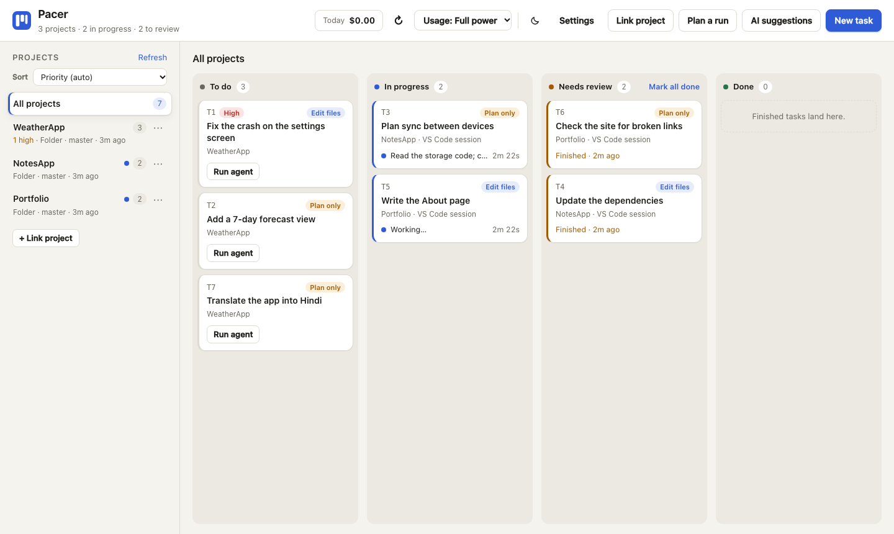
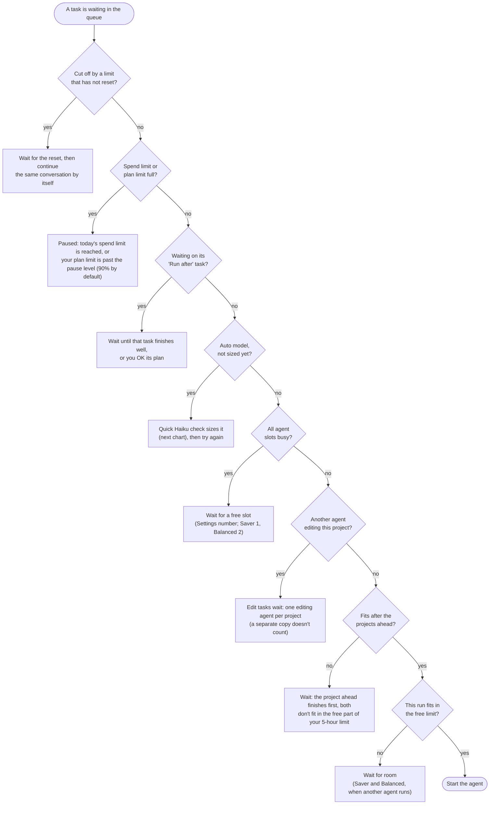
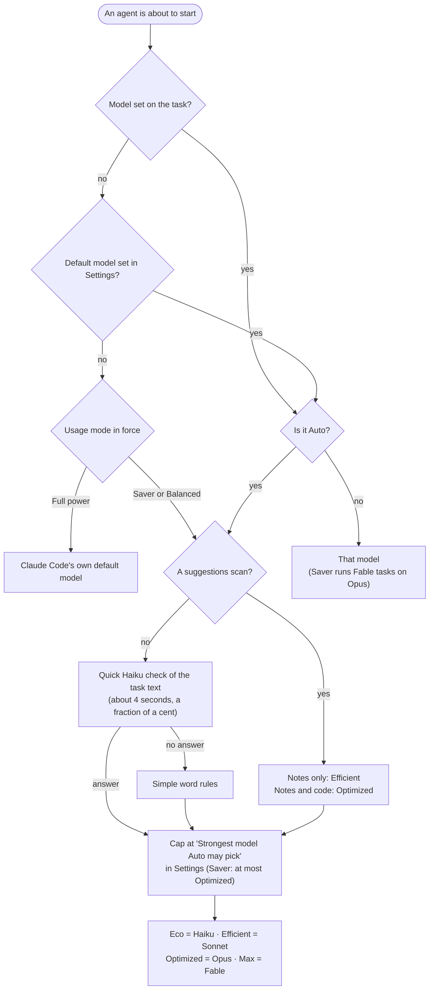
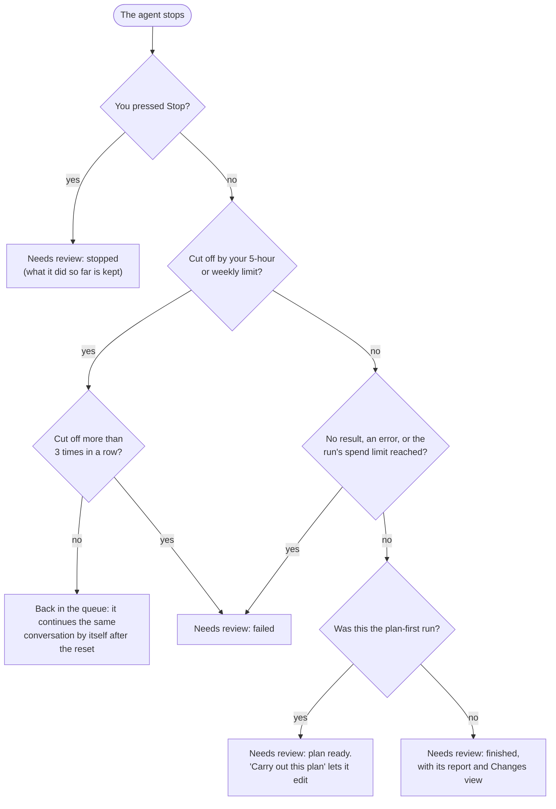

# Pacer

[](https://github.com/Trilokia/pacer/actions/workflows/test.yml)
[](LICENSE)
[](https://nodejs.org/)
[](#requirements)
[](package.json)

A task board for all your projects that runs on your own computer (macOS, Windows or Linux). You link project folders, add tasks, and either let Pacer start Claude Code agents on them or let your own Claude sessions in VS Code pick them up. It paces the agents against your Claude plan limits, so a long queue finishes whole projects instead of leaving every project half done when the limit runs out. Progress and final reports show up on the board. Flowcharts in [How Pacer decides](#how-pacer-decides) show when tasks start, which model they use and what happens when a run ends.

Pacer is a small web app: a Node server on your computer, and a page you open in your browser. It needs only Node (no `npm install`). It listens on your computer only and is not reachable from the network. It runs on your computer rather than as a website because it starts `claude` in your project folders.



> Pacer is an independent project. It is not made by or affiliated with Anthropic. "Claude" and "Claude Code" are trademarks of Anthropic.

## Requirements

- **macOS, Windows 10/11 or Linux.** macOS is where Pacer is used every day; on Windows and Linux the tests run on every push (see [Tests](#tests)).
- **Node.js 20 or newer.** There is nothing to install with npm.
- **Claude Code** (the `claude` command), signed in. Agents use your own Claude plan or API key, and everything they do counts against your limits. Pacer finds `claude` on your PATH, in the usual install folders, or inside the VS Code extension; if it can't, set the path in Settings.
- **git**, for project status, the Changes view and separate copies. On Windows, Claude Code itself also needs Git for Windows.
- Optional: **VS Code** with the Claude Code extension (for the "Continue in VS Code" buttons) and the GitHub **`gh`** command (for pull requests from separate copies).

## Before you use "Edit files"

An **Edit files** task starts an agent that changes files in your project without asking you first. It runs in Claude Code's `auto` permission mode, which blocks risky actions by itself, and Pacer stops it from committing or pushing (see [Limits that keep things safe](#limits-that-keep-things-safe)). Still:

- Use it only on projects under git, so you can see and undo every change. Each task's **Changes** view shows what it did.
- Start with **Plan only** tasks (the default) until you trust how it works.
- Review the changes before you commit them. Agents never commit; you do.

## Install

```
git clone https://github.com/Trilokia/pacer.git
cd pacer
node server.js
```

## Start it

- **macOS:** double-click `start.command`.
- **Windows:** double-click `start.cmd`.
- **Any system:** run `node server.js --open` (or just `node server.js`, then open http://localhost:4577).

Keep the terminal window open; closing it stops Pacer and any agents it started.

## Light and dark

The moon / sun button in the top bar switches between the light and the dark theme. The page follows your computer's setting until you choose; Settings has "Same as this computer" to go back to that.

## Projects

- **Link project** remembers a folder. Nothing is copied, moved or changed.
- **Find projects inside it** lists the folders inside a parent folder so you can link many at once.
- Each project shows its kind, git branch, number of uncommitted files and last commit. **Refresh** re-reads these.
- The `···` button on a project opens its details: rename, change the folder, set a status, deadline and notes, open it in your file manager (Finder, File Explorer) or VS Code, or unlink it.
- **Tags** group similar projects, for example by framework ("Android", "Node") or by kind of work ("Client work"). Type them in a project's details, with commas between them; the chips under the box add a tag another project already has, or the project's kind, with one click. The tags then show as chips above the project list. Click one to see only those projects and their tasks; click it again to see everything. A project can have up to 8 tags.
- **Sort** above the list picks the order:

| Sort | Order |
|---|---|
| Priority (auto) | A deadline in the next 2 weeks first (nearest first), then most high-priority open tasks, then most tasks waiting for review, then most open tasks |
| Recently opened / Least recently opened | By when you last clicked the project in the list, or opened it in the file manager or VS Code |
| Most opened | By how often you opened it |
| A to Z | By name |
| Custom | Your own order: drag projects, or press Alt+Up / Alt+Down on a selected one. Dragging in any other sort switches to Custom |

Paused and shipped projects stay below the active ones, except in Custom. The list doesn't reshuffle while your mouse is on it, so the project you click stays put. The sort choice, your custom order and the open history are saved in this browser only. The add-task and AI-suggestions dialogs list projects in the same order.

## Tasks

Every task belongs to one project and moves through four columns: **To do**, **In progress**, **Needs review**, **Done**.

Each task has a setting for what an agent may do:

| Setting | What the agent does |
|---|---|
| Plan only | Reads the code and writes findings and a plan. Changes nothing. |
| Edit files | Does the work and runs builds or tests. Never commits or pushes. |

**Run agent** starts a background Claude agent in the project's folder. You can watch each step, stop it, and read its report when it finishes. On a finished task you can:

- **Send a follow-up** to the same agent. It remembers what it did.
- **Carry out this plan**, which turns a plan-only task into an editing run.
- Continue the agent yourself in a terminal with the `claude --resume …` line shown at the bottom of the task.

**Mark all done.** The Needs review column has a **Mark all done** link. Press it, then press again to confirm, and every task in the column (for the project you are looking at) moves to Done. Suggestion scans stay, so you can still add their suggestions.

**A task for a project that does not exist yet.** In **New task**, choose "+ New empty project…" in the Project box. Give it a name and the folder to make it in. Pacer makes one empty folder (with a git repository, unless you untick that), links it, and adds the task to it.

### Several agents in one project: separate copies

Normally two agents never edit the same project at once; the second waits. Tick **Work in a separate copy** on an "Edit files" task (in New task, in the task's details, or for all lines in Several tasks) and that task gets its own copy of the project on its own branch, so several can edit one project together.

- The copy is a git worktree in a hidden `.dashboard-copies` folder next to the project. It starts from the project's last commit, so uncommitted work in the project is not in it. The project needs at least one commit.
- `local.properties`, `.env` and `.env.local` are copied in, but only when git ignores them, so they can never end up in a commit.
- When the task is finished you choose: **Apply to project** puts the changes into the project folder, uncommitted, like a normal task. **Open pull request** asks for a title and description, then commits the changes under your name, pushes the branch and opens the pull request with `gh`. Nothing is merged. **Remove the copy** throws it away.
- If two copies changed the same lines, the second "Apply" is refused: use a pull request for that one.
- Marking the task done removes its copy once the changes are applied or in a pull request.

### Order and repeats

- **Run after** (in a task's details) makes a task wait until another one has finished. In Several tasks, "In each project, run them one after another" sets this for the whole list.
- **Repeat** runs a task again every day or every week after it last finished. A suggestions scan simply looks again; any other task gets a fresh copy of itself.

### Notifications

Pacer shows a desktop notification when a task finishes, needs your OK, or your limit runs out (on Linux this needs `notify-send`). Several at once are folded into one. Settings can turn this off, and can also send the same lines to your phone through ntfy.sh if you give it a topic name (that sends the task id, project name and title to that outside service).

### Working on a task yourself in VS Code

A task's details have a button that moves it into the Claude panel of VS Code, for when you want to steer it by hand:

- **Continue in VS Code** (a task that already has a conversation): opens the project in VS Code and that same conversation in the Claude panel, with everything said so far. The task shows **In progress** as yours, so Pacer does not run its own agent on it at the same time. When you are done, press **Finished in VS Code**: the task goes to Needs review and its Changes section shows what changed while you worked. After that, "Send a follow-up" works again and the agent knows what you did in VS Code.
- **Start in VS Code** (a task that has not run yet): opens VS Code with a short message ready in the Claude box. Press Enter there. Claude reads the task from the board, takes it, and reports back when it finishes, and the conversation is linked to the task.

Good to know:

- The first time, VS Code asks whether the Claude Code extension may open the link. Tick "Do not ask me again" and press Open.
- A folder VS Code has never opened asks whether you trust it. Until you answer, the Claude panel cannot open there. Answer, then press the button again.
- The project opens in its own VS Code window. A conversation can only be opened from a window on that same folder.

### Several tasks at once

In **New task**, choose "Add several tasks at once". Write one task per line and tag its project with `@Name` (click a tag button to insert it, or type the start of the name, like `@wea`). Tag two or more projects on one line to give the same task to each. Indent a line to add details to the task above it:

```
@WeatherApp Fix the crash on the settings screen
    It happens when the city list is empty.
@WeatherApp @NotesApp Update the dependencies
```

"Add and run agents" starts them all; agents beyond the limit wait in the queue.

Each task in the list can have its own setting. Add `!edit` or `!plan` to a line, or click the "Plan only" / "Edit files" label next to the task in the list under the box. Lines without one use the "Agent may (default)" box.

```
@WeatherApp Fix the crash on the settings screen !edit
@NotesApp How should sync between devices work? !plan
```

A link like `http://localhost:4577/#T12` opens that task.

### AI suggestions

**AI suggestions** (top bar) asks Claude where your projects stand and what to do next. Tick the projects, choose what Claude looks at, and press **Look at projects**. One read-only agent runs per project; it changes nothing.

| Look at | What Claude does |
|---|---|
| Notes and plan files (quick) | Reads `CLAUDE.md`, `README`, `TODO` and other `.md` files in the project and its `docs/` or `plans/` folders, and checks the code to see what is still left. About a minute per project. |
| Notes, plans and the code (thorough) | The same, then studies the code for its own ideas: likely bugs, missing tests, release blockers. Several minutes and much more usage. |
| The code only | Skips the notes. |

If the project sits in a folder with a shared `CLAUDE.md` (for example several apps in one parent folder), the `plans/` and `docs/` folders next to it are read too.

Each project comes back with a short summary and a list of suggestions, marked "Left in your notes" or "AI idea". Tick the ones you want, switch any of them between Plan only and Edit files, and press **Add to board** or **Add and run agents**. Each new task gets the model level the scan judged it needs.

Only the projects ticked in the list show their suggestions, so tick one project to see just that one. Each project's result folds open and shut by clicking its name; it starts open while it has suggestions you haven't added yet. Suggestions already on the board are folded away under "N already added".

A scan shows on the board as a card marked **Suggestions**. Open it to read the result again, send a follow-up ("look closer at the tests"), or **Look again**. Mark it done when you have taken what you want. Tasks already on the board are not suggested again.

### Which model a task uses

| Choice | Model | Good for |
|---|---|---|
| Auto | picked per task | Lets Pacer decide (see below) |
| Eco | Haiku | Chores: run commands, collect information, read logs |
| Efficient | Sonnet | Small, clearly described changes |
| Optimized | Opus | Features across files, bugs, plans |
| Max | Fable | Design decisions, release work, the hardest problems |
| Default | whatever Settings says | |

**Auto** first asks Haiku what kind of task it is. That takes a few seconds and costs far less than a cent. The task's activity then shows the pick and the reason, for example "Auto picked Efficient (sonnet): small one-string change". If the check does not answer, simple word rules decide. A follow-up stays on the model the first run used.

In **Settings** you can make Auto the model for every task set to "Default", and set the strongest model Auto may pick (for example Optimized, so Auto never uses Fable).

### Claude conversations

Claude Code saves every conversation on your computer, per folder. Pacer reads them (it never changes them):

- **Conversations** on a project (next to its path on the board, or in its `···` details) lists the saved conversations for that folder. Click one to read it.
- A task's **Conversations** section shows the Pacer agent's own conversation and any you linked with **Link a conversation**.
- A VS Code session that claims, notes or finishes a task through `dash.js` links its own conversation to that task automatically.

Both add-task dialogs show the chosen project's recent conversations on the right, so you can see where it stands while you write. Open one to see what you last asked and how Claude ended.

Claude removes saved conversations after about 30 days, and chats on claude.ai are not stored on your computer, so neither can be shown.

### Reviewing what changed

A finished "Edit files" task has a **Changes** section: every file the task touched, with the added and removed lines. It compares the project with how it was when the task started, so you see only that task's work. This needs the project to be a git repository; recording it never touches your git index or history.

### Usage and budgets

The strip at the top shows today's spend and how full your Claude plan limits are. Click it for spend by day and by project, and to set budgets:

- **Daily spend limit:** once reached, queued tasks wait until tomorrow.
- **Spend limit for one agent run:** a run that reaches it stops and lands in Needs review. Each task can have its own limit.
- **Plan-limit pause:** new agents wait when your 5-hour or weekly Claude limit is this full (90% by default), so background work does not use up what you need yourself.

Paused tasks start again by themselves, or press **Run anyway**. Dollar amounts are what the runs would cost at API prices; on a Claude subscription you are not billed them. The plan-limit numbers update each time a Pacer agent runs. While tasks are paused by a full limit, Pacer reads the limit again every 5 minutes, so a limit that was reset early is noticed and the queue starts again. **Refresh** reads it right away: the ↻ button next to the usage strip, or the Refresh button in the Usage dialog.

### Usage mode

The **Usage** switch in the top bar sets how careful agents are with your Claude limit. It applies to agents that start after you change it.

| | Saver | Balanced | Full power |
|---|---|---|---|
| A task set to "Default" runs on | Auto | Auto | Claude Code's own model |
| Strongest model | Optimized (Opus), even if a task says Max | no cap | no cap |
| Thinking effort | lower on Haiku and Sonnet | normal | normal |
| Spend limit for one run | $3 unless you set one | only if you set one | only if you set one |
| A task Auto sizes as Max | plans first, edits after your OK | runs directly | runs directly |
| Agents at once | 1 | 2 | the number in Settings |
| Starting agents | by room in the limit | by room in the limit | by count |

**Starting by room in the limit.** In Saver and Balanced, Pacer estimates how much of your 5-hour limit a run will take, from your own past runs on that model, and starts a waiting task only if it fits under the plan-limit pause level next to the agents already running. So small tasks can run side by side, while a big Fable task may have to wait for the one before it. A waiting task says how much it needs and how much is free; **Run anyway** starts it regardless. The first agent is never held this way. The estimates and what they are based on are shown under "What one agent run usually takes" in the Usage dialog. They are rough: your own Claude sessions use the same limit.

**Saver by itself.** When your 5-hour limit is 70% full, Pacer acts as Saver whatever mode you picked, and the usage strip shows "Saver until reset". Your own mode comes back when the limit resets. Change the level, or empty the box to switch this off, under Budgets in the Usage dialog.

**Agents at once.** Saver runs one agent at a time and Balanced two, never more than the number in Settings. **Run anyway** on a waiting task starts it regardless. **Run all anyway** at the top of the To do column does this for every waiting task shown (the chosen project or tag, or all); it shows when two or more are waiting, and asks once before it starts them, because many agents at once can use up your limit in minutes.

**Plan first.** In Saver, a task that Auto sizes as Max only plans on its first run. Read the plan, then press **Carry out this plan** to let the agent edit files.

**Cut off by a limit.** In every mode, an agent that your 5-hour or weekly limit cuts off goes back in the queue and continues the same conversation by itself once the limit resets (also after a restart of Pacer). If it is cut off more than three times in a row it stops and waits for you. **Cancel** on such a task keeps what it did so far.

### One project after another, and Plan a run

Waiting tasks start **one project after another**: agents finish all waiting tasks of one project before they begin the next. So when your limit runs out, some projects are finished and the others are untouched, not every project half done.

- The order: a project agents are already working on, then the order you chose in Plan a run, then the project that needs the least of your limit (that way the most projects get finished). Inside a project, tasks go by priority and time as before.
- With two or more agents at once, a second project starts next to the first only when both fit in what is free of your 5-hour limit. If they do not fit, its tasks say which project is finished first. **Run anyway** starts one regardless.
- A task that waits for you (for example its "Run after" task needs your OK) does not hold other projects back.

**Plan a run** (top bar) shows, for every project with open tasks, about how much of your 5-hour limit they will take, the usage in dollars and the agent time, next to how much of the limit is free now. Tick projects to see the total and which ones still fit; **Pick the most that fit** ticks as many whole projects as fit, smallest first. The arrows change the order. **Run … in this order** queues every To do task of the ticked projects.

The numbers are rough: they come from your own past runs on each model, they count the 5-hour limit only, and your own Claude sessions use the same limit. A project that does not fit still starts when its turn comes; its tasks wait for the reset when the limit is full and then continue by themselves.

To go back to the old order (priority and time only, projects mixed), choose "Mixed" under "How waiting tasks start" in Plan a run.

### Limits that keep things safe

- At most 2 agents run at once by default. You choose the number in Settings or in the "several tasks" dialog, up to one per project (16 at most). Pacer tells you what your computer's memory can comfortably take, but the choice is yours. Extra tasks wait in the queue.
- Two agents never edit the same project at the same time.
- Agents cannot commit or push. A check runs before each of their shell commands (`guard/pre-tool.js`), and git itself refuses through hooks in `guard/githooks/` that apply only to agent runs. Your own git commands are not affected.
- Editing agents run in Claude Code's `auto` permission mode, which blocks risky actions on its own.
- Agents follow each project's `CLAUDE.md`, like any Claude session.

## How Pacer decides

These charts follow the code in `server.js` (`pump()`, `chooseModel()` and the end of `launchAgent()`).

### When a waiting task starts

Pacer looks at the queue whenever something changes, and at least once a minute. It tries the waiting tasks in line order: first by project (a project agents are already working on, then the one it started last, then your order from **Plan a run**, then the project that needs the least of your limit), then by priority, then by when the task was queued. Each task goes through these checks; the first "wait" it hits is the reason shown on its card.



- **Run anyway** skips every check except three: Auto sizing, the agent number in Settings, and one editing agent per project.
- The first agent is never held by the estimate. When another agent is running, Pacer reads your limit again first if the last reading is more than 3 minutes old.
- With "Mixed" order (in **Plan a run**) the project check is skipped and tasks go by priority and time only.

### Which model a run uses



- The usage mode "in force" is the one you picked, except that Pacer acts as **Saver** while your 5-hour limit is 70% full or more (you can change this level).
- In Saver, Haiku and Sonnet also think less, every run gets a $3 spend limit unless you set one, and an Edit task that Auto sizes as Max only plans on its first run.
- With Auto, a follow-up keeps the model of the task's first run. If you change a task's title, details or mode, Auto sizes it again.

### When a run ends



After every editing run, whatever the outcome, its changes are recorded as a patch (the **Changes** view). Agents never commit: you review and commit.

## Using the board from a VS Code Claude session

Sessions use `dash.js` from inside a linked project folder:

```
node /path/to/pacer/dash.js list          # open tasks for this project
node /path/to/pacer/dash.js show T12      # full task text
node /path/to/pacer/dash.js claim T12     # take it (In progress)
node /path/to/pacer/dash.js note T12 "…"  # progress note
node /path/to/pacer/dash.js done T12 "…"  # short report (Needs review)
node /path/to/pacer/dash.js fail T12 "…"  # could not finish
node /path/to/pacer/dash.js add "Title" -d "details" --mode plan|edit
```

In a session you can simply say "pick up T12 from Pacer".

## Known limits

- Used every day on macOS. On Windows and Linux the automatic tests pass (they start and stop a stand-in agent), but these extras have not been tried by hand yet: desktop notifications, the **Browse…** folder picker (PowerShell on Windows, `zenity` on Linux) and the VS Code buttons. If one fails, type the folder path instead, or use phone notifications.
- Pacer reads some parts of Claude Code's output that are not a documented interface: the plan-limit readings, the model names (haiku, sonnet, opus, fable) and the VS Code extension's link format. A Claude Code update can break the usage features or the VS Code buttons until Pacer is updated.
- Usage estimates are rough and cover the 5-hour limit only, not the weekly one.
- Less tested so far, on every system: the last step of the VS Code buttons (the Claude panel showing the conversation), and pull requests from separate copies against a real GitHub repository.

## Tests

```
npm test
```

This starts Pacer on a spare port with a throwaway data folder and checks that it serves the page, refuses requests from other websites, stores projects and tasks, finds `claude` on PATH, and starts, finishes and stops an agent. The agent is a stand-in (`test/fake-claude.js`), so no real agent runs and nothing is spent.

GitHub Actions runs the same tests on Windows (Node 20 and 22) and Linux on every push: see `.github/workflows/test.yml`.

## Files

| File | What it is |
|---|---|
| `server.js` | The server: stores data, starts and watches agents |
| `public/` | The page you see in the browser |
| `dash.js` | Command-line helper for Claude sessions |
| `guard/` | The no-commit checks used during agent runs |
| `test/` | Tests (`npm test`) and the stand-in agent they use |
| `start.command`, `start.cmd` | Double-click starters for macOS and Windows |
| `data/db.json` | Your projects and tasks (created on first start) |
| `data/runs/` | The raw output of every agent run, one file per task |
| `data/changes/` | The recorded changes of each task, as patch files |

Settings you can pass when starting: `DASH_PORT` (default 4577) and `DASH_DATA` (default `./data`).

## License

MIT. See [LICENSE](LICENSE).
